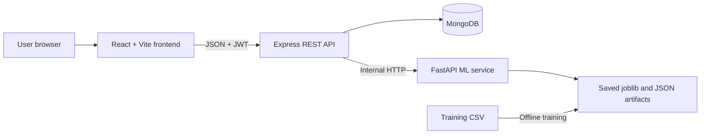

# Lung Cancer Prediction System
## Current Working and Proposed Evidence Upload Functionality

> **Medical disclaimer:** This project is for educational and research use. It is not a medical diagnosis system. Uploaded medical information must not be used to make treatment decisions without qualified clinical review.

# Part I: Complete Current Working

## 1. Purpose

The application estimates lung-cancer risk from structured demographic, lifestyle, and symptom values. A user signs in, completes the assessment form, submits it, and receives a `High Risk` or `Low Risk` label, a probability, and the deployed model name. The prediction is saved to the authenticated user's history.

The current model is trained from `ml-service/data/lung_cancer.csv`. The CSV contains fields such as `GENDER`, `AGE`, smoking, yellow fingers, anxiety, peer pressure, chronic disease, fatigue, allergy, wheezing, alcohol consumption, coughing, shortness of breath, swallowing difficulty, chest pain, and the `LUNG_CANCER` target.

## 2. System Architecture



The frontend never connects directly to MongoDB or the FastAPI service. The Express backend owns authentication, validation, prediction orchestration, persistence, and error translation.

## 3. Main Project Areas

- `frontend/`: React pages, prediction form, result display, charts, authentication context, and Axios services.
- `backend/`: Express routes, controllers, validation, JWT authentication, MongoDB models, and ML-service client.
- `ml-service/`: FastAPI endpoints, Pydantic schemas, preprocessing, inference, and offline training scripts.
- `ml-service/data/`: Source CSV used for training.
- `ml-service/artifacts/`: Persisted Bagging model, preprocessing pipeline, selected-feature metadata, and model metadata.
- `ml-service/results/`: Model comparison and forward-elimination results, plus generated evaluation plots.
- `docker-compose.yml`: Optional MongoDB, ML, backend, and frontend container orchestration.

## 4. Authentication and Access

1. A visitor registers or logs in through the React login/register page.
2. The Express auth routes validate the request, hash or verify the password with bcrypt, and issue a JWT.
3. The frontend keeps the authenticated session in `AuthContext` and sends the token in the `Authorization: Bearer <JWT>` header.
4. `backend/src/middleware/auth.js` verifies the JWT and attaches the user identity to the request.
5. Prediction, dashboard, history, model, and results routes are protected. Prediction records are queried by the authenticated `userId`.

## 5. Current Prediction User Flow

1. The user opens the protected `/predict` page.
2. `PredictionForm.jsx` initializes `GENDER`, `AGE`, and 13 binary lifestyle/symptom fields.
3. Gender is selected from a dropdown and age from an 18-to-95 range control.
4. Lifestyle and symptom cards toggle each field between `0` and `1`.
5. On submit, the form converts `AGE` to a number and calls `predictionService.createPrediction`.
6. The frontend sends JSON to `POST /api/predictions`.
7. The backend authenticates the user and validates that `GENDER` exists and `AGE` is an integer from 1 to 120.
8. `predictionController.create` calls the backend prediction service.
9. The backend prediction service calls the ML service at `POST /predict`.
10. The FastAPI Pydantic schema validates every required CSV feature as `GENDER`, `AGE`, or a binary integer.
11. The ML service loads saved artifacts on first use, builds a one-row DataFrame, applies the saved preprocessing transformer, keeps the selected features, and calls the Bagging Classifier.
12. The ML service returns the risk label, probability, and model name.
13. The backend saves the original structured input and returned result in MongoDB.
14. The API returns the saved prediction with HTTP `201`.
15. The frontend displays the result and scrolls to it.

## 6. Current Prediction API Contract

### Frontend to Express

`POST /api/predictions` with a JWT and JSON containing all model fields:

```json
{
  "GENDER": "M",
  "AGE": 65,
  "SMOKING": 1,
  "YELLOW_FINGERS": 1,
  "ANXIETY": 0,
  "PEER_PRESSURE": 0,
  "CHRONIC_DISEASE": 1,
  "FATIGUE": 1,
  "ALLERGY": 0,
  "WHEEZING": 1,
  "ALCOHOL_CONSUMING": 1,
  "COUGHING": 1,
  "SHORTNESS_OF_BREATH": 1,
  "SWALLOWING_DIFFICULTY": 0,
  "CHEST_PAIN": 1
}
```

### Express to FastAPI

The backend forwards the same JSON to `POST /predict` on the ML service. FastAPI returns:

```json
{
  "prediction": "High Risk",
  "probability": 0.87,
  "modelName": "BaggingClassifier"
}
```

### Stored MongoDB document

The `Prediction` model stores `userId`, the complete `inputData` object, `prediction`, `probability`, `modelName`, `createdAt`, and `updatedAt`. The current schema has no upload metadata, file references, extracted evidence, or processing status.

## 7. Machine-Learning Pipeline

1. `scripts/train.py` loads the CSV. If it is missing, a synthetic same-schema dataset is generated.
2. Dataset utilities normalize columns and common binary encodings.
3. The data is split into stratified training and test sets.
4. A preprocessing pipeline standardizes numeric columns and one-hot encodes categorical columns.
5. Logistic Regression, Decision Tree, Random Forest, SVM, and Bagging models are compared.
6. Sequential forward feature elimination runs using the training split and cross-validation only.
7. The primary Bagging Classifier uses decision trees and the selected features.
8. Metrics, plots, selected features, preprocessing, model, and metadata are saved under `ml-service/artifacts/` and `ml-service/results/`.
9. Runtime inference uses those saved artifacts; it does not retrain from a user's prediction.

## 8. Dashboard and History

- `GET /api/predictions` lists the authenticated user's saved predictions newest first.
- `GET /api/predictions/:id` retrieves one owned prediction.
- `DELETE /api/predictions/:id` deletes one owned prediction.
- `GET /api/dashboard/stats` returns totals, high/low risk counts, averages, distribution, and recent records.
- Model and evaluation routes expose deployed model metadata, model comparison, and feature-elimination history.

## 9. Running the Current System

### ML service

```bash
cd ml-service
python -m venv venv
# Activate the environment using the command for the current shell
pip install -r requirements.txt
python scripts/train.py
uvicorn app.main:app --reload --port 8000
```

### Backend

```bash
cd backend
npm install
npm run dev
```

Configure `MONGODB_URI`, `JWT_SECRET`, `ML_SERVICE_URL`, and `CLIENT_URL` in the backend environment.

### Frontend

```bash
cd frontend
npm install
npm run dev
```

Configure `VITE_API_URL`, normally `http://localhost:5000/api`.

### Docker

`docker compose up --build` starts MongoDB, the ML service, the backend, and the frontend. The ML artifacts and data/results directories are mounted as volumes.

## 10. Current Limitations Relevant to the Requested Change

- The UI has no Yes/No gate that controls evidence questions.
- The UI has no file inputs, upload progress, file validation, or per-evidence state.
- Express uses `express.json()` only; it does not currently process `multipart/form-data` uploads.
- The backend stores only structured survey values and the model result.
- The ML schema rejects unknown evidence fields and expects all existing CSV features.
- The current model has never been trained on images, blood reports, doctor reports, or ECG signals, so simply attaching files cannot make them affect its prediction.
- Medical documents contain sensitive personal data and require strict access control, retention, encryption, and deletion decisions.


# Part II: What To Do For Yes/No-Driven Evidence Uploads

## 11. Define the Product and Clinical Scope First

Before coding, create a field-by-field evidence matrix. For every Yes/No answer, define whether it requests an upload, which file types are allowed, whether the upload is optional, who reviews it, and what machine-readable feature is extracted. Example: `YELLOW_FINGERS = Yes` may request a finger image; `BLOOD_REPORT = Yes` may request a PDF or image; `ECG = Yes` may request a PDF/image or a standard waveform export.

Do not claim that an upload proves or diagnoses lung cancer. Decide whether each upload is only stored for clinician review, used to extract a validated feature, or used by a separately trained model. Keep the existing CSV prediction as a baseline until evidence models have sufficient labeled data and evaluation.

## 12. Recommended End-to-End User Flow

1. User completes the existing demographic and CSV survey fields.
2. For each evidence question, the UI presents explicit `Yes` and `No` buttons.
3. Selecting `Yes` immediately reveals the matching upload control and accepted file formats.
4. Selecting `No` hides and clears that upload requirement, with a clear confirmation before deleting an already selected file.
5. The UI validates file type, size, count, and required evidence before enabling submission.
6. The client uploads structured answers and files as `multipart/form-data` only after the user submits the complete assessment.
7. The backend authenticates the request, validates all fields and files, stores files privately, and creates an assessment with `pending` processing status.
8. The processing service extracts evidence features or marks the file for manual review.
9. The prediction service combines the original CSV features with only approved, defined evidence features.
10. The backend saves the inputs, file metadata, extraction status, model version, and output as one auditable assessment.
11. The UI shows the prediction together with evidence-processing status and a medical disclaimer.

## 13. Frontend Changes

Update `PredictionForm.jsx` with a separate evidence section rather than mixing file controls into binary symptom cards. Maintain state such as `evidenceAnswers`, `evidenceFiles`, and per-file validation errors. Use accessible buttons or radios for Yes/No, and use a real file input with an associated label for each visible upload request.

Add reusable components such as `EvidenceQuestion`, `EvidenceUpload`, `FilePreview`, and `UploadStatus`. Define evidence metadata in one configuration object so the question text, field name, accepted MIME types, maximum size, and required behavior do not drift across the UI.

Update the submit handler and `predictionService` to build `FormData`. Append structured fields as JSON and append each selected file under a stable field name such as `evidence[YELLOW_FINGERS]` or `evidence[BLOOD_REPORT]`. Do not put raw file bytes in JSON or base64 unless there is a measured reason to do so.

## 14. Backend API and Storage Changes

Change the prediction route to accept `multipart/form-data` using a maintained upload middleware such as Multer, configured with memory or controlled temporary storage, strict file-size limits, MIME allowlists, and a maximum number of files. Keep authentication before upload processing where practical.

Add validation for:

- Required demographic and CSV fields.
- Valid Yes/No evidence answers.
- A required file whenever its answer is `Yes`.
- No unexpected evidence field names.
- File extension and detected content type, not only the client-provided MIME type.
- Maximum file size, dimensions, page count, and upload count.
- Malware scanning and safe filename/object-key generation.

Create an evidence storage abstraction. For a prototype, use a private local directory outside the public frontend build. For deployment, use private object storage with encryption, short-lived signed access URLs, and lifecycle deletion. Never expose upload directories through static public routes.

Extend the MongoDB schema with assessment-level evidence metadata, for example:

```js
{
  evidence: [{
    type: String,
    answer: Boolean,
    storageKey: String,
    originalName: String,
    contentType: String,
    size: Number,
    sha256: String,
    processingStatus: String,
    extractedFeatures: Object,
    reviewStatus: String
  }],
  predictionInputVersion: String,
  modelVersion: String,
  processingStatus: String
}
```

Store metadata and references rather than unencrypted report contents in MongoDB. Add ownership checks to every evidence download, replacement, and deletion endpoint.

## 15. ML and Data Strategy

There are three possible implementation levels:

### Level 1: Upload for review only

Keep the current CSV model unchanged. Store the uploads, show processing/review status, and let a clinician inspect them. This is the safest first increment because no unsupported evidence is silently converted into a model decision.

### Level 2: Extract structured features, then use a tabular model

Create separate extractors for each evidence type:

- Finger image: image-quality checks and a narrowly defined, clinically justified feature only if labeled training images exist.
- Blood report: OCR plus a reviewed laboratory parser that maps known analytes, units, reference ranges, and dates into structured values.
- Doctor report: OCR and document classification or clinician-entered structured fields; avoid unconstrained diagnosis extraction.
- ECG: use a validated ECG parser for standardized waveform data, not arbitrary screenshots alone.

Add explicit missingness indicators for evidence that was answered `No`, not uploaded, failed quality checks, or is pending review. Normalize extracted values and version the extractor. Retrain a new tabular model with a dataset containing the same structured features and target labels.

### Level 3: Multimodal model

Train separate image, document, and ECG encoders and combine their embeddings with CSV features in a fusion model. This requires a large, representative, consented, labeled dataset, patient-level train/test separation, external validation, calibration, bias analysis, explainability, monitoring, and clinical review. The existing CSV alone is insufficient for this approach.

Do not send raw uploads to the current `PredictionInput` schema. Add a new evidence-processing contract and only pass validated extracted features to a model that was trained to accept them.

## 16. Suggested Service Boundaries

- **Express API:** authentication, request validation, upload authorization, assessment lifecycle, persistence, and response formatting.
- **Evidence service:** private file storage, virus scanning, OCR/document parsing, image checks, ECG parsing, and extractor versioning.
- **ML service:** baseline CSV model plus an evidence-aware endpoint that accepts a versioned structured feature payload.
- **Background worker:** long-running OCR, image, ECG, and model inference jobs so HTTP requests do not time out.
- **MongoDB:** assessment metadata, processing status, extracted feature audit trail, prediction output, and model/extractor versions.

A practical API shape is:

- `POST /api/assessments`: create an assessment and upload selected evidence.
- `GET /api/assessments/:id`: return owned assessment status and result.
- `GET /api/assessments/:id/evidence/:evidenceId`: return a short-lived authorized download.
- `DELETE /api/assessments/:id/evidence/:evidenceId`: delete the file and metadata.
- Internal `POST /evidence/process`: process one evidence item.
- Internal `POST /predict`: accept CSV features plus approved extracted features and model version.

## 17. Testing and Acceptance Criteria

Add frontend tests for Yes/No state changes, conditional visibility, clearing files after No, required-file validation, unsupported types, oversized files, and submit-disabled states. Add backend tests for authentication, ownership, multipart parsing, validation failures, storage failures, duplicate requests, and deletion.

Add ML tests for missing evidence, invalid extracted values, extractor version mismatches, baseline-only fallback, probability output, and reproducibility. Use fixture files with no real patient data.

Acceptance criteria should include: no prediction is generated before required evidence processing completes; a No answer never leaves a stale file attached; every stored file belongs to the authenticated user; unsupported files are rejected; failed extraction is visible; the response identifies the model and extractor versions; and the system clearly states whether uploaded evidence affected the result.

## 18. Recommended Implementation Order

1. Add the evidence matrix and user-flow acceptance criteria.
2. Add Yes/No UI state and conditional upload controls with client validation.
3. Add authenticated multipart handling and private file storage without changing the model.
4. Add assessment records, processing statuses, ownership checks, and secure retrieval/deletion.
5. Add one evidence extractor as a proof of concept using synthetic or consented labeled data.
6. Define and version extracted features; keep baseline CSV predictions available for comparison.
7. Train and evaluate an evidence-aware model only with an appropriate labeled dataset.
8. Add background jobs, monitoring, audit logs, privacy controls, and external validation.
9. Update Swagger, README, and project report with the final contract and limitations.
10. Demonstrate the feature using test files and synthetic data, never real medical records.

## 19. Key Decision

The smallest defensible change is to add conditional uploads and secure evidence storage first, while continuing to generate the existing CSV-based prediction. Evidence should affect prediction only after a defined extractor and a model trained and evaluated with that evidence type exist. This prevents the application from presenting unsupported file interpretation as a medically meaningful prediction.
