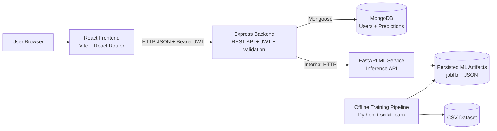
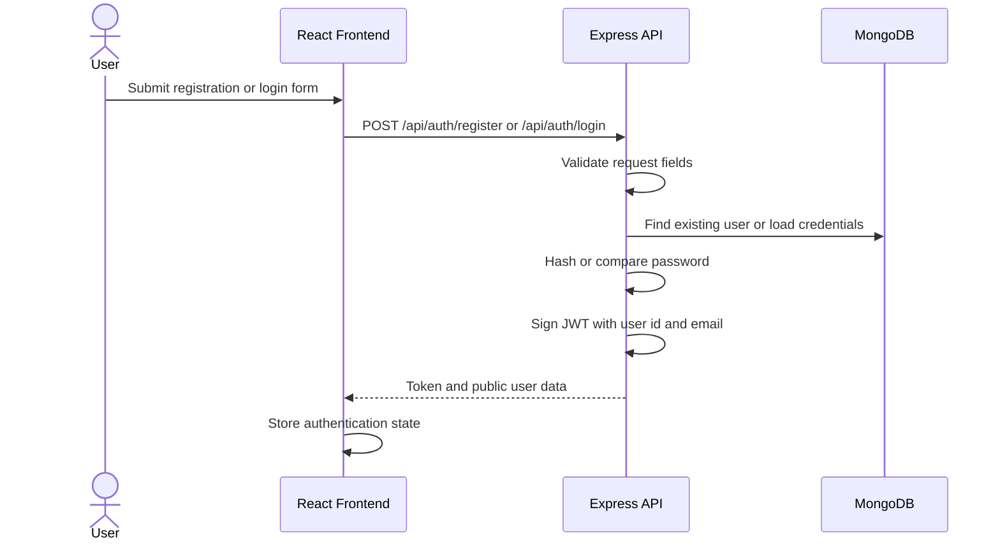
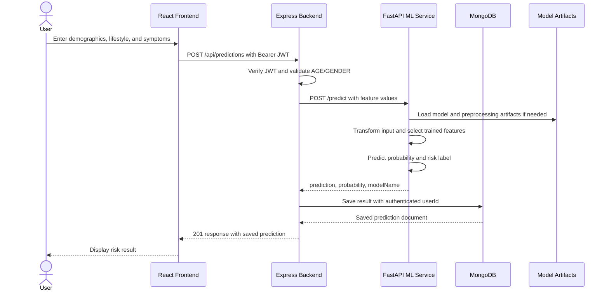
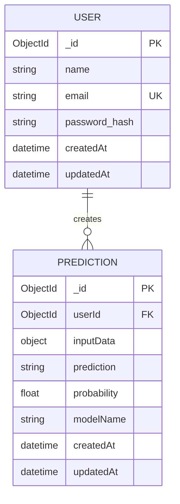
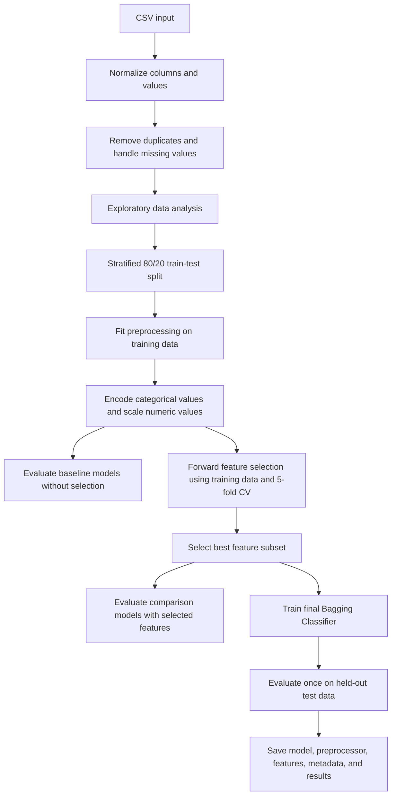
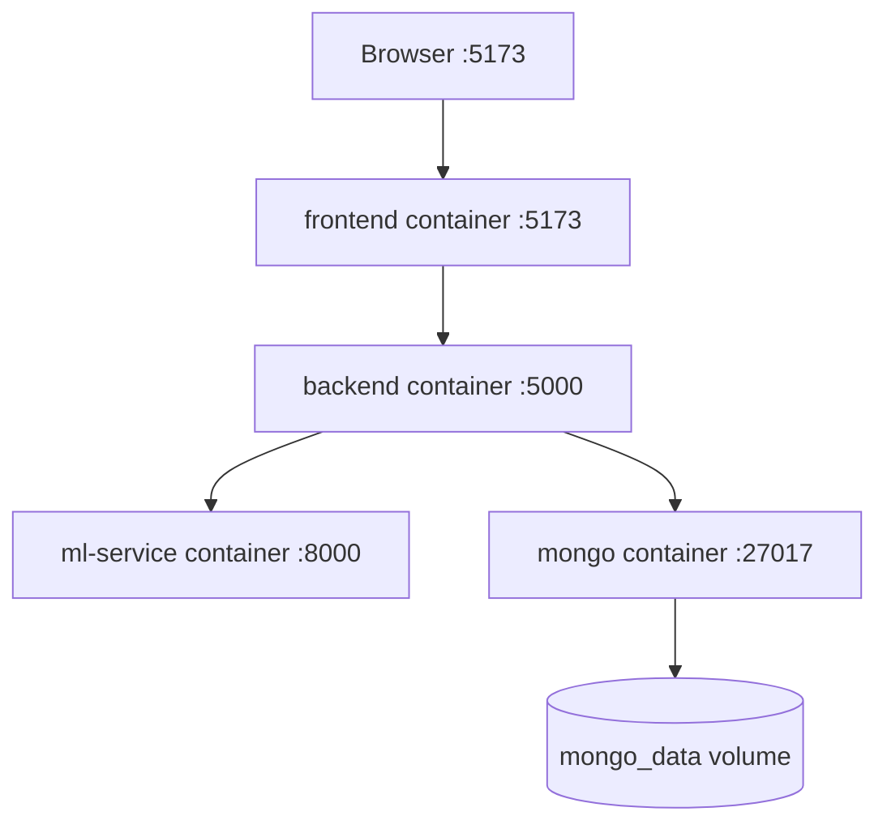

# Lung Cancer Risk Prediction System

## Project Report and Complete System Design

## 1. Executive Summary

The Lung Cancer Risk Prediction System is a full-stack web application that estimates lung cancer risk from demographic, lifestyle, and symptom information. It combines a React user interface, an Express and Node.js application server, MongoDB persistence, and a Python FastAPI machine-learning service.

The system supports user registration and login, authenticated risk prediction, prediction history, a dashboard with aggregate statistics, model information, and model evaluation results. The deployed prediction model is a scikit-learn Bagging Classifier using decision trees as base estimators. Before classification, the system applies the same persisted preprocessing pipeline used during training and selects features using sequential forward feature elimination.

This project is intended for educational and research use. It is not a medical diagnostic system and must not replace assessment by a qualified healthcare professional.

## 2. Problem Statement

Lung cancer risk factors are distributed across demographic information, lifestyle behavior, and symptoms. A user-friendly system is needed to:

- Collect structured risk-factor information.
- Apply a repeatable machine-learning prediction process.
- Return a risk category and probability estimate.
- Preserve prediction history for authenticated users.
- Present model and historical information through a web dashboard.
- Separate the web application from the model-serving and training concerns.

## 3. Objectives

1. Provide a simple browser-based interface for risk prediction.
2. Protect user accounts and prediction history with authentication and authorization.
3. Expose a stable backend API for the frontend.
4. Isolate machine-learning inference in a dedicated service.
5. Use consistent preprocessing during training and production inference.
6. Compare multiple classification algorithms and record evaluation results.
7. Make the complete solution runnable locally or with Docker Compose.

## 4. Scope

### Included

- User registration, login, and current-user lookup.
- JWT bearer authentication.
- Password hashing with bcrypt.
- Prediction form with demographic, lifestyle, and symptom fields.
- High Risk or Low Risk prediction result.
- Probability returned by the model.
- Per-user prediction history and deletion.
- Dashboard statistics and recent predictions.
- Model metadata and evaluation result endpoints.
- Dataset cleaning, exploratory analysis, feature selection, training, evaluation, and artifact persistence.
- Local and Docker-based deployment configuration.

### Not Included

- Clinical diagnosis or treatment recommendations.
- Doctor or hospital workflow integration.
- Real-time model retraining from user predictions.
- Administrative roles or multi-tenant organization management.
- Monitoring, alerting, distributed tracing, or production secret management.
- Explainable-AI explanations for individual predictions.

## 5. Users and Use Cases

| Actor | Use case | Description |
|---|---|---|
| Visitor | View landing page | Learn about the application and its purpose. |
| Visitor | Register | Create an account using name, email, and password. |
| Registered user | Log in | Receive a JWT access token. |
| Registered user | Submit assessment | Enter risk-factor values and request a prediction. |
| Registered user | View result | See risk label, probability, and model name. |
| Registered user | View dashboard | See total, high-risk, low-risk, average probability, chart data, and recent results. |
| Registered user | View history | Review saved predictions belonging to that user. |
| Registered user | Delete history item | Remove one of the user's saved predictions. |
| Registered user | View model information | See deployed model metadata and evaluation results. |
| Developer or evaluator | Use API documentation | Explore Express Swagger UI and FastAPI OpenAPI documentation. |

## 6. System Architecture

### 6.1 High-Level Architecture



### 6.2 Architectural Style

The application uses a layered service-oriented architecture:

- **Presentation layer:** React pages and reusable components.
- **API layer:** Express routes, controllers, validation middleware, and error handling.
- **Application/service layer:** Authentication, prediction orchestration, dashboard aggregation, and ML-service client logic.
- **Persistence layer:** Mongoose models for users and predictions.
- **Model-serving layer:** FastAPI endpoints that load persisted artifacts and perform inference.
- **Model-development layer:** Offline Python scripts for data preparation, feature selection, model comparison, and artifact generation.

The frontend never connects directly to MongoDB or FastAPI. This keeps authentication, authorization, persistence, and integration policy inside the Express backend.

### 6.3 Component Responsibilities

#### Frontend

- `App.jsx` defines public and protected routes.
- `ProtectedRoute` prevents unauthenticated access to application pages.
- `AuthContext` manages authentication state.
- Pages include landing, login, registration, dashboard, prediction, history, and about views.
- Services use Axios to call the Express API.
- Recharts components visualize risk distribution, risk gauge data, and model comparison information.

#### Backend

- Express initializes middleware, health check, API routes, Swagger UI, and error handling.
- Authentication service hashes passwords, verifies credentials, and creates JWTs.
- Prediction service calls the ML service and persists the returned result.
- Dashboard service computes per-user totals and recent predictions.
- ML service client provides the backend-to-FastAPI integration and translates downstream failures to API errors.
- Mongoose models define the MongoDB data contract.

#### ML Service

- FastAPI provides prediction, health, model-info, features, comparison, and feature-elimination endpoints.
- The prediction service loads the model, preprocessing pipeline, feature metadata, and model metadata.
- The training script produces all required runtime artifacts.
- Data utilities normalize column names and common binary encodings.

## 7. Detailed Request Flow

### 7.1 Authentication Flow



### 7.2 Prediction Flow



### 7.3 Dashboard and History Flow

1. The frontend sends a request with the JWT.
2. Express authentication middleware identifies the user.
3. The dashboard service queries only documents matching `userId`.
4. Results are sorted newest first.
5. The service calculates total, high-risk count, low-risk count, average probability, risk distribution, and the five most recent records.
6. The API returns the aggregate data to the dashboard.

## 8. Frontend Design

### 8.1 Routes and Views

| Route | Access | Purpose |
|---|---|---|
| `/` | Public | Landing page. |
| `/login` | Public | Login form. |
| `/register` | Public | Registration form. |
| `/dashboard` | Protected | User statistics and recent predictions. |
| `/predict` | Protected | Prediction form and result. |
| `/history` | Protected | Saved prediction list and deletion. |
| `/about` | Protected | Application and model information. |

Protected views use a shared layout containing the sidebar, navigation bar, and page content.

### 8.2 Main Frontend Components

- `PredictionForm`: captures the model input fields.
- `PredictionResult`: presents the returned prediction.
- `PredictionTable`: displays saved records.
- `MetricCard`: displays dashboard measures.
- `RiskChart` and `RiskGauge`: visualize risk information.
- `ModelComparisonChart`: visualizes stored model comparison data.
- `LoadingSpinner` and `ErrorMessage`: provide request state feedback.

## 9. Backend API Design

All Express responses use the project response helpers and return a success flag with data or an error response. Protected endpoints require:

```text
Authorization: Bearer <JWT>
```

### 9.1 Public Endpoints

| Method | Endpoint | Purpose |
|---|---|---|
| `GET` | `/api/health` | Backend health check. |
| `POST` | `/api/auth/register` | Create a user and issue a JWT. |
| `POST` | `/api/auth/login` | Authenticate a user and issue a JWT. |
| `GET` | `/api-docs` | Express Swagger UI. |

### 9.2 Protected Endpoints

| Method | Endpoint | Purpose |
|---|---|---|
| `GET` | `/api/auth/me` | Return the current user. |
| `POST` | `/api/predictions` | Run and save a prediction. |
| `GET` | `/api/predictions` | List the current user's predictions. |
| `GET` | `/api/predictions/:id` | Retrieve one owned prediction. |
| `DELETE` | `/api/predictions/:id` | Delete one owned prediction. |
| `GET` | `/api/dashboard/stats` | Return dashboard aggregates. |
| `GET` | `/api/model/info` | Return deployed model metadata. |
| `GET` | `/api/results/model-comparison` | Return model comparison results. |
| `GET` | `/api/results/feature-elimination` | Return forward-elimination history. |

### 9.3 Prediction Input Contract

| Field | Type | Meaning |
|---|---|---|
| `GENDER` | string | `M` or `F`. |
| `AGE` | integer | Age from 1 to 120. |
| `SMOKING` | integer | Binary indicator, 0 or 1. |
| `YELLOW_FINGERS` | integer | Binary indicator, 0 or 1. |
| `ANXIETY` | integer | Binary indicator, 0 or 1. |
| `PEER_PRESSURE` | integer | Binary indicator, 0 or 1. |
| `CHRONIC_DISEASE` | integer | Binary indicator, 0 or 1. |
| `FATIGUE` | integer | Binary indicator, 0 or 1. |
| `ALLERGY` | integer | Binary indicator, 0 or 1. |
| `WHEEZING` | integer | Binary indicator, 0 or 1. |
| `ALCOHOL_CONSUMING` | integer | Binary indicator, 0 or 1. |
| `COUGHING` | integer | Binary indicator, 0 or 1. |
| `SHORTNESS_OF_BREATH` | integer | Binary indicator, 0 or 1. |
| `SWALLOWING_DIFFICULTY` | integer | Binary indicator, 0 or 1. |
| `CHEST_PAIN` | integer | Binary indicator, 0 or 1. |

The ML service returns:

```json
{
  "prediction": "High Risk",
  "probability": 0.87,
  "modelName": "BaggingClassifier"
}
```

## 10. Data Design

### 10.1 Entity Relationship



### 10.2 User Collection

- `name`: required trimmed string.
- `email`: required, lowercase, trimmed, unique string.
- `password`: required hashed value and excluded from normal queries.
- `createdAt` and `updatedAt`: managed by Mongoose timestamps.

Passwords are never returned as part of the public user response.

### 10.3 Prediction Collection

- `userId`: required reference to the owning user.
- `inputData`: complete submitted feature object.
- `prediction`: model label, normally `High Risk` or `Low Risk`.
- `probability`: numeric positive-class probability.
- `modelName`: name of the deployed model.
- `createdAt` and `updatedAt`: managed by Mongoose timestamps.

Ownership is enforced by querying with both the prediction id and authenticated user id. This prevents a user from reading or deleting another user's prediction by id.

## 11. Machine-Learning System Design

### 11.1 Dataset

The expected dataset is the public Lung Cancer Survey-style CSV with:

- `GENDER` and `AGE`.
- Binary lifestyle and symptom fields.
- `LUNG_CANCER` as the target column.

The loader normalizes column names by trimming, uppercasing, and replacing spaces with underscores. Cleaning removes exact duplicate rows, removes rows without a target, fills missing numeric values with the median, fills missing categorical values with the mode, normalizes gender, converts common Yes/No and 1/2 encodings to 0/1, and converts the target to integer 0/1.

If the dataset file is missing, the training script generates a synthetic placeholder dataset so the complete system can be executed. This data must not be treated as a substitute for a validated clinical dataset.

### 11.2 Training Pipeline



### 11.3 Preprocessing

The training pipeline creates a scikit-learn `ColumnTransformer`:

- Numeric columns use `StandardScaler`.
- Categorical columns use `OneHotEncoder(handle_unknown="ignore")`.

The fitted preprocessor is saved as `preprocessing.joblib`. During inference, the same object transforms the incoming row, preventing training/inference preprocessing drift.

### 11.4 Sequential Forward Feature Elimination

The implemented selector follows a greedy sequential forward selection process:

1. Start with no selected features.
2. Try each remaining feature when added to the current selected set.
3. Score each candidate with cross-validation on the training split only.
4. Add the candidate with the highest mean score.
5. Stop when the improvement is below `0.001` after at least one feature or when the maximum feature count is reached.

The configured limits are five-fold cross-validation and at most ten selected features. The held-out test set is not used for selection.

### 11.5 Models Compared

The training script compares the following models:

- Logistic Regression.
- Decision Tree.
- Random Forest.
- Support Vector Machine with probability support.
- Bagging Classifier with a Decision Tree base estimator.

Each model is evaluated both with all preprocessed features and with the selected feature subset. The comparison records accuracy, precision, recall, F1 score, and ROC-AUC when probability output is available.

### 11.6 Deployed Model and Inference

The final deployed model is a `BaggingClassifier` with 100 decision-tree estimators. The inference process:

1. Loads artifacts on startup or on first use.
2. Extracts the raw feature columns recorded during training.
3. Builds a one-row pandas DataFrame.
4. Applies the persisted preprocessor.
5. Maps selected feature names to encoded-column indices.
6. Sends the selected matrix to the Bagging model.
7. Reads the positive-class probability from `predict_proba`.
8. Returns `High Risk` when probability is at least `0.5`; otherwise returns `Low Risk`.

### 11.7 ML Artifacts

| Artifact | Purpose |
|---|---|
| `artifacts/bagging_model.joblib` | Trained production classifier. |
| `artifacts/preprocessing.joblib` | Fitted scaling and encoding pipeline. |
| `artifacts/selected_features.json` | Raw columns, encoded names, and selected features. |
| `artifacts/model_metadata.json` | Model identity, training time, metrics, row counts, and feature counts. |
| `results/model_comparison.json` | Metrics for models with and without forward elimination. |
| `results/forward_elimination_history.json` | Feature-selection steps and cross-validation scores. |
| `results/*.png` | EDA, confusion matrix, ROC curve, and model comparison visualizations. |

## 12. ML Service API

| Method | Endpoint | Purpose |
|---|---|---|
| `GET` | `/health` | ML service health check. |
| `GET` | `/model/info` | Return model metadata. |
| `GET` | `/features` | Return selected and raw feature columns. |
| `POST` | `/predict` | Validate input and return a prediction. |
| `GET` | `/results/model-comparison` | Return saved comparison JSON. |
| `GET` | `/results/feature-elimination` | Return saved feature-selection JSON. |
| `GET` | `/docs` | FastAPI-generated OpenAPI documentation. |

The Express backend calls the ML service internally and translates downstream errors into `502` or `503` API errors.

## 13. Security Design

### Implemented Controls

- Passwords are hashed using bcryptjs with a work factor of 10.
- JWTs are signed with the configured secret and have a configured expiration.
- Protected routes require a valid bearer token.
- Prediction queries enforce ownership through `userId`.
- Express uses Helmet security headers.
- CORS is restricted to the configured client URL in the backend.
- Request validation is applied to authentication and prediction route inputs.
- MongoDB access is encapsulated by the backend rather than exposed to the browser.
- Password fields are excluded from normal user queries.

### Security Improvements Recommended for Production

- Replace the sample JWT secret with a strong secret stored in a secret manager.
- Use HTTPS for all external traffic.
- Add rate limiting and account lockout controls to authentication endpoints.
- Add stricter validation for `GENDER` and all prediction fields at the Express boundary.
- Avoid logging sensitive request data.
- Restrict FastAPI CORS and network access because the service is intended for internal use.
- Add dependency scanning, container image scanning, and security headers verification.
- Consider short-lived access tokens with refresh-token rotation.
- Encrypt backups and protect MongoDB credentials.

## 14. Error Handling and Reliability

The Express application uses a not-found middleware and a centralized error handler. Controller functions pass errors to that handler rather than formatting errors independently. The ML client distinguishes between:

- A downstream ML response error, translated to HTTP `502`.
- An unavailable or unreachable ML service, translated to HTTP `503`.

FastAPI returns `503` when required artifacts do not exist and `400` when an inference operation fails after request validation.

### Reliability Considerations

- MongoDB data uses a Docker named volume for persistence in Compose.
- ML artifacts are mounted from the host in Compose, allowing retraining without rebuilding the service image.
- The backend waits on service dependencies through Compose configuration, but a production deployment should also implement readiness checks and retry/backoff.
- The ML client has a ten-second request timeout.
- There is currently no retry queue, circuit breaker, or prediction idempotency key.

## 15. Deployment Design

### 15.1 Docker Compose Services



The Compose configuration defines:

- MongoDB 7 on port `27017`.
- FastAPI ML service on port `8000`.
- Express backend on port `5000`.
- Vite frontend on port `5173`.
- A named `mongo_data` volume.
- Host mounts for ML data, artifacts, and results.

### 15.2 Configuration

#### Backend

```text
PORT=5000
MONGODB_URI=mongodb://localhost:27017/lung_cancer_risk
JWT_SECRET=<strong-secret>
ML_SERVICE_URL=http://localhost:8000
CLIENT_URL=http://localhost:5173
```

#### Frontend

```text
VITE_API_URL=http://localhost:5000/api
```

#### ML Service

```text
DATASET_PATH=data/lung_cancer.csv
MODEL_PATH=artifacts
```

In Docker Compose, service-to-service URLs use container names, such as `mongodb://mongo:27017/lung_cancer_risk` and `http://ml-service:8000`.

### 15.3 Local Startup Sequence

1. Install Python dependencies in `ml-service`.
2. Place the real CSV in `ml-service/data/lung_cancer.csv`, or allow synthetic data generation.
3. Run `python scripts/train.py` from `ml-service`.
4. Start FastAPI with `uvicorn app.main:app --reload --port 8000`.
5. Install backend dependencies and start Express with `npm run dev`.
6. Install frontend dependencies and start Vite with `npm run dev`.
7. Open the frontend at `http://localhost:5173`.

Alternatively, run `docker compose up --build` from the project root.

## 16. Technology Stack

| Area | Technologies |
|---|---|
| Frontend | React 18, React Router, Axios, Recharts, Lucide React, Vite, CSS |
| Backend | Node.js, Express, Axios, Mongoose, MongoDB, JWT, bcryptjs, Helmet, CORS |
| API documentation | Swagger UI and OpenAPI for Express, FastAPI OpenAPI docs |
| ML service | Python, FastAPI, Pydantic, Uvicorn |
| Data and ML | pandas, NumPy, scikit-learn, joblib |
| Analysis and charts | matplotlib, seaborn |
| Deployment | Docker, Docker Compose |

## 17. Testing and Verification Strategy

The current repository does not include a dedicated automated test suite. The following verification plan is recommended:

### Unit Tests

- Validate authentication input and password behavior.
- Test JWT acceptance, expiration, and rejection.
- Test dataset normalization and binary encoding conversion.
- Test forward feature selection stopping behavior.
- Test prediction label threshold behavior at probabilities below, equal to, and above `0.5`.
- Test dashboard calculations for empty and non-empty histories.

### Integration Tests

- Register, log in, and call `/api/auth/me`.
- Submit a prediction through Express and verify the saved MongoDB document.
- Verify a user cannot retrieve or delete another user's prediction.
- Verify ML-service unavailable behavior returns the expected gateway error.
- Verify model-info and results endpoints return persisted artifacts.

### End-to-End Tests

- Complete the browser flow from registration through prediction and history review.
- Confirm protected routes redirect unauthenticated users.
- Confirm dashboard charts match API data.

### Model Verification

- Confirm train/test separation.
- Confirm feature selection uses training data and cross-validation only.
- Record accuracy, precision, recall, F1, and ROC-AUC on the held-out test set.
- Check confusion matrix and ROC curve.
- Validate that the production preprocessor and selected feature metadata are compatible with the saved model.

## 18. Limitations and Risks

- The probability is a machine-learning estimate, not a clinically calibrated risk score.
- Model quality depends on dataset quality, representativeness, labeling, and class balance.
- The fallback synthetic dataset is useful for development only.
- The binary threshold of `0.5` is fixed and has not been justified using clinical cost analysis.
- No fairness analysis is implemented for demographic groups.
- No model drift detection or scheduled retraining is implemented.
- Predictions store submitted health-related information and require appropriate privacy controls in real deployments.
- The current backend validates `GENDER` presence but the ML schema defines the accepted shape more strictly.
- Docker Compose configuration is suitable for local development, not a complete production deployment platform.

## 19. Future Enhancements

1. Add automated unit, integration, and end-to-end tests.
2. Add request rate limiting, structured logging, health/readiness checks, and metrics.
3. Add model versioning and include a version identifier in every prediction record.
4. Add probability calibration and threshold selection based on medical false-positive and false-negative costs.
5. Add explainability, such as feature contribution summaries, with appropriate warnings.
6. Add dataset validation, experiment tracking, and reproducible training manifests.
7. Add fairness, subgroup performance, and data drift reports.
8. Use managed secrets, TLS, backups, and restricted network policies in deployment.
9. Add pagination and database indexes for large prediction histories.
10. Add clinician review workflows and explicit consent/privacy controls for any real-world use.

## 20. Conclusion

The project implements a complete, modular risk-prediction workflow. React provides the user experience, Express centralizes authentication and business orchestration, MongoDB stores user-scoped history, and FastAPI isolates model inference. The offline training pipeline provides reproducible cleaning, preprocessing, feature selection, model comparison, evaluation, and artifact generation. This separation makes the system understandable and extensible while preserving a clear path toward stronger testing, monitoring, model governance, and production security.

The system should remain positioned as an educational and research prototype until it has undergone clinical validation, privacy review, fairness evaluation, security hardening, and appropriate regulatory assessment.
